  

  <a href="https://github.com/sanjay456789">GitHub Profile</a>　·　<strong>Build</strong>　·　<strong>Learn</strong>　·　<strong>Share</strong>

---

  

## Let's start with the big idea

Every project here began as a question. Here is how I approach it, one step at a time:

1. **Start small.** Pick one piece of the problem you can understand today.
2. **Build it.** Write the code, even if it's messy. Messy code is still code you can learn from.
3. **Explain it.** If you can explain a concept in plain words, you truly understand it.
4. **Share it.** Put it out in the open so others can check the work and teach me something back.

Think of it like learning to ride a bike: you don't read the whole manual first. You wobble, adjust, and try again.

## Key ideas I keep coming back to

  
  

- **Explain it simply.** If an idea feels hard, break it into smaller pieces. Each piece should be something you could draw on a napkin.
- **Practice builds progress.** Progress is slow at first, and then it clicks. Keep going.
- **Mistakes are signposts.** A bug shows exactly where understanding needs more work.

## What I'm working on right now

  
  

Here is the plan, in order:

- Build small projects that solve one clear problem.
- Write down what I learned after each one.
- Improve a little each week, rather than rushing toward a big finish.

## Let's connect

Have a question, an idea, or a suggestion? Ask away. Questions help me learn as much as they help you.

Start a conversation through [my GitHub profile](https://github.com/sanjay456789).

  Thanks for stopping by. Keep learning, keep building ✨

